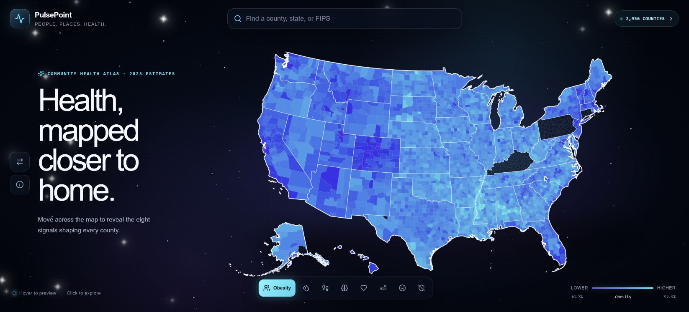
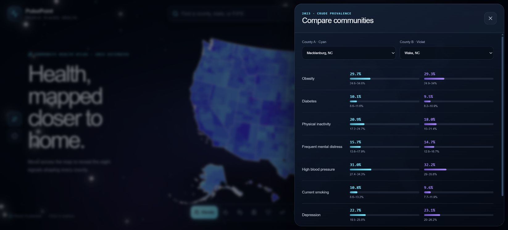
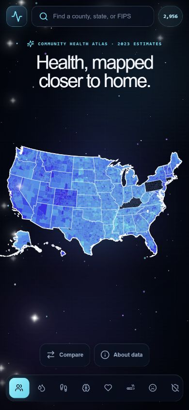

# PulsePoint

### Community health, mapped closer to home.

Explore eight public health indicators across U.S. counties through an interactive atlas, county snapshots, searchable filters, and side-by-side comparisons.

**[Launch the live atlas →](https://pulse-point-dashboard.vercel.app/)** · [Source code](https://github.com/juanthom99/PulsePoint-Dashboard) · [CDC PLACES data](https://data.cdc.gov/500-Cities-Places/PLACES-Local-Data-for-Better-Health-County-Data-20/swc5-untb)

The included dataset contains **2,956 counties and 23,648 observations**, with eight indicators per county, labeled **2023**. These are historical, modeled estimates—not real-time health readings. The app shows the active year, estimate type, and data source in **About data**. No visitor account is required.

[](https://pulse-point-dashboard.vercel.app/)

## Explore the atlas

- Select an indicator to recolor the county map. Hover for an eight-indicator preview or select a county to pin its details.
- Search by county, state, or five-digit FIPS identifier. Explore counties with state, value, missing-data, and sorting controls.
- Open **Compare** to examine two counties, including each estimate's 95% confidence interval.
- Open **About data** for the observation year, source, uncertainty, and coverage notes. On a phone, use search or the county list to select small counties.
- Import a compatible CDC CSV to explore another dataset locally in the browser. Importing a file does not write it to Supabase.

## Indicators at a glance

Values are estimated percentages. Most measures cover adults aged 18 or older; the health-insurance measure covers ages 18–64. Exact definitions and survey questions are maintained by [CDC PLACES](https://www.cdc.gov/places/measure-definitions/index.html).

| Indicator | What it describes |
| --- | --- |
| Obesity | Adults whose reported height and weight meet the obesity threshold |
| Diabetes | Adults reporting a diabetes diagnosis, excluding gestational diabetes |
| Physical inactivity | Adults reporting no leisure-time physical activity in the past month |
| Frequent mental distress | Adults reporting at least 14 days of poor mental health in the past month |
| High blood pressure | Adults reporting a high blood pressure diagnosis |
| Current smoking | Adults meeting CDC's current cigarette-smoking definition |
| Depression | Adults reporting a depression diagnosis |
| Lack of health insurance | Adults aged 18–64 reporting no current health insurance |

## Read the numbers responsibly

**Historical estimates.** PLACES combines survey and demographic information to model small-area prevalence. Connecting to Supabase retrieves the stored dataset; it does not update the observation period. The included eight measures use 2023 survey data in the CDC release described in the [release notes](https://www.cdc.gov/places/current-release-notes/index.html).

**Uncertainty.** A 95% confidence interval communicates uncertainty around a modeled estimate. Point estimates and interval overlap alone are not a formal test of a difference. County summaries do not describe an individual resident or establish causation.

**Coverage.** Kentucky and Pennsylvania lack estimates for 2023 BRFSS-based measures in this release. Missing values remain unavailable, never zero or invented data. The app does not infer why an individual county is absent. County boundaries use `us-atlas`, derived from U.S. Census cartographic boundaries, and can differ from the health dataset's boundary vintage.

**Comparison.** The bundled snapshot contains crude prevalence. Compare the same measure, year, and estimate type. Crude prevalence does not adjust away differences in county age distributions. No composite health score or overall ranking is calculated.

## Screenshots

### County comparison



### Phone layout



Screenshots show the application itself, rather than design mockups.

## Architecture

```text
GitHub main → Vercel → Next.js / React interface
                         ├─ Supabase public county observations (preferred)
                         └─ Bundled CDC CSV (outage fallback)
```

The interface uses Tailwind CSS, Lucide icons, SVG county geometry, and a customized **shadcn/ui Card** in the About data panel. Configuration lives in `components.json`; attribution is in [THIRD_PARTY.md](THIRD_PARTY.md).

Supabase reads are paginated to include the full table. An unavailable or empty database falls back to the bundled snapshot; **About data** identifies the active source. Public table access is read-only under row-level security. The schema and import instructions are included in the repository.

## Run locally

Requires Node.js 20.9 or later.

```bash
npm ci
# Copy .env.example to .env.local and fill in the public Supabase values.
npm run dev
```

Open `http://localhost:3000`. With both public connection values configured, Supabase is preferred. Set `NEXT_PUBLIC_DATA_SOURCE=csv` to explicitly use the bundled snapshot. Never put a service-role key in frontend configuration.

For a new Supabase project, run [supabase/schema.sql](supabase/schema.sql) in its SQL editor and import `public/data/places.csv` into `pulsepoint_observations`. Configure `NEXT_PUBLIC_SUPABASE_URL` and `NEXT_PUBLIC_SUPABASE_PUBLISHABLE_KEY` in Vercel, then redeploy. Keep the GitHub repository connected to the Vercel project so pushes to `main` deploy the app.

```bash
npm test
npm run build
npm start
```

The tests cover CSV parsing, five-digit FIPS preservation, missing values, duplicate rejection, map helpers, snapshot coverage, and database-outage behavior.

## Refresh the snapshot

Download a compatible PLACES county CSV, then run:

```bash
npm run prepare:csv -- path/to/download.csv
```

Review years, estimate types, coverage, and any changed definitions before publishing. Long-format CSVs preserve their year field. GIS-friendly wide files do not carry a per-measure year; the current parser assigns 2023, so adapting it is necessary before importing a different survey vintage. The command regenerates `public/data/places.csv`; import the reviewed file into Supabase separately to update the hosted table.

## Repository guide

| Path | Purpose |
| --- | --- |
| `components/dashboard.jsx` | Search, filters, county details, comparison, and data explanations |
| `components/county-map.jsx` | Interactive county geometry |
| `components/ui/card.jsx` | Customized shadcn/ui Card primitive |
| `lib/data.mjs` | CDC CSV normalization and indicator labels |
| `lib/load-data.mjs` | Database and snapshot loading strategy |
| `public/data/places.csv` | Versioned public-data snapshot |
| `supabase/schema.sql` | Table, constraints, and public read policy |
| `tests/` | Data and map behavior checks |
| `docs/screenshots/` | Captured desktop and phone views |
